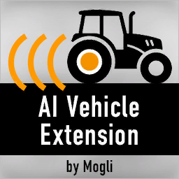

  

# AI Vehicle Extension для Farming Simulator 25

**Актуальная версия: 2.6.0.1 · Неофициальная адаптация AIVE от Mogli для FS25.**

[Скачать мод](https://github.com/HeboRGger/AIVehicleExtension/releases/latest/download/FS25_AIVehicleExtension.zip) · [Релизы](https://github.com/HeboRGger/AIVehicleExtension/releases/latest) · [Исходники FS25](FS25_AIVehicleExtension/) · [Оригинальный проект](https://github.com/Mogli12/AIVehicleExtension) · [Лицензия GPL](LICENSE.txt)

**Для установки в игру скачивайте файл `FS25_AIVehicleExtension.zip` из Releases. Пункты `Source code` и `Code → Download ZIP` скачивают исходники репозитория.**

AIVE расширяет возможности полевого помощника: работа по неровной кромке, круговой режим с загонками, совместная обработка поля до четырёх машин и запуск задания через штатное меню карты «Дать работу». В этой ветке находятся только текущая сборка и исходники для **Farming Simulator 25**.

## Что умеет мод

### Работа в поле

- Обработка полей со сложными и неровными краями с учётом установленного оборудования.
- Круговой режим, движение туда-обратно, прямой режим и **«Круговой с загонкой»**.
- Выбор левой или правой рабочей стороны, разворотной полосы, числа кругов, смещения рабочей ширины, отступа разворота и точности распознавания.
- Несколько манёвров разворота, в том числе с задним ходом; режим работы реверсом для подходящей техники.
- Локальный объезд препятствий с учётом габаритов машины и орудия. Возможность проезда зависит от коллизий объекта и свободного места.
- Ожидание разгрузки комбайна, настройка внесения удобрения сеялкой и положения орудия при развороте.
- Пауза и продолжение работы, сохранение контрольных точек задания для возобновления, отображение распознанной кромки.

### «Дать работу» на карте

В стандартном меню FS25 доступно задание **«Работа в поле + AIVE»**. Игрок выбирает машину, точку и направление у поля, настраивает работу и запускает задание. Помощник выполняет переезд, выравнивается у края поля и передаёт управление полевой стратегии AIVE.

Для переезда предусмотрены:

- автоматический выбор подходящего источника маршрута;
- штатные дороги GIANTS;
- дорожная сеть AutoDrive, если она загружена;
- дороги карты на основе доступных дорожных сплайнов.

Мод проверяет доступ к полю, подготовку оборудования, наличие требуемых материалов и сезон посева. При невозможности начать работу, блокировке или длительном отсутствии продвижения используются сообщения задания. На прямых транспортная скорость ограничивается возможностями техники, на поворотах — до **12 км/ч**; при тесных манёврах, препятствиях и заходе на поле скорость ниже.

**Дорога, нарисованная на карте, сама по себе не является маршрутом для ИИ.** Для дорожного переезда нужна связная сеть GIANTS, AutoDrive или пригодные сплайны карты. Если их нет, потребуется сеть маршрутов для этой карты либо ручной подвод машины к полю.

### До четырёх помощников на одном поле

Общий серверный диспетчер распределяет рабочие участки, учитывает обработанную поверхность, резервирует полосы и согласует проезд и развороты машин. Это помогает помощникам работать совместно и уменьшать повторную обработку.

Для группы у каждой машины в задании выберите:

1. Тип движения **«Круговой с загонкой»**.
2. В дополнительных настройках — **«Совместная работа (до 4)» → «Вкл.»**.
3. Прямой ход: работа реверсом для группы должна быть выключена.

Назначайте помощников на одно поле, оставляя достаточно места для захода и разворота. Групповой режим рассчитан максимум на четыре машины; качество совместного движения зависит от размеров техники, формы поля и препятствий.

### Подруливание и ванильный GPS

- Собственное подруливание AIVE по кромке включается отдельной командой **Alt+7**. Игрок управляет движением; мод помогает удерживать границу обработки. При включении существующий режим может опускать орудие, а при потере кромки — отключать круиз.
- Штатная помощь в рулении FS25 сохраняет приоритет. Выберите её через удержание **H**, настройте курс и подтвердите его: короткое **H** активирует или отключает выбранную полосу без найма работника AIVE.
- Отдельный новый режим «GPS AIVE» на клавише H пока не реализован. Подруливание по кромке и штатный GPS — разные функции.

### Производительность

Используются кэширование рабочих данных, распределение проверок во времени и общий диспетчер поля. Для диагностики есть отключённый по умолчанию профилировщик: консольные команды `aiveProfile on`, `aiveProfile report`, `aiveProfile off`. Прирост FPS зависит от карты, техники, оборудования и других модов; фиксированный процент не заявляется.

## Установка

1. Скачайте **[FS25_AIVehicleExtension.zip](https://github.com/HeboRGger/AIVehicleExtension/releases/latest/download/FS25_AIVehicleExtension.zip)**. Кнопка GitHub **Code → Download ZIP** скачивает весь репозиторий и не даёт готовый установочный мод.
2. Поместите файл **без распаковки** в `Документы/My Games/FarmingSimulator2025/mods`.
3. Уберите из mods предыдущую копию AIVE, чтобы игра не загрузила две версии одновременно.
4. Включите AI Vehicle Extension в списке модов нужного сохранения.

AutoDrive и Courseplay не обязательны. AutoDrive нужен только при выборе его дорожной сети. В моде есть защита от одновременного управления машиной внешним помощником и AIVE.

В XML заявлена поддержка мультиплеера, групповой диспетчер работает на сервере. Это не означает, что проверены все сочетания карт, техники и модов на выделенном сервере.

## Запуск и клавиши

Привязки по умолчанию в **2.6.0.1**. `Alt`, `Ctrl` и `Shift` в таблице — левые клавиши.

| Клавиши | Действие |
|---|---|
| **H** | Запуск/остановка выбранного работника или включение/отключение полосы ванильного GPS |
| **Удержание H** | Штатное меню выбора ИИ-работника / помощи в рулении |
| **Alt+H** | Показать/скрыть быстрый HUD AIVE |
| **Shift+H** | Дополнительная стандартная привязка показа HUD |
| **Ctrl+H** | Открыть расширенные настройки AIVE |
| **Alt+P** | Пауза / продолжение работы помощника AIVE |
| **Alt+7** | Подруливание AIVE по кромке |
| **Alt+5** | Переключить круговой / челночный режим |
| **Alt+6** | Сменить рабочую сторону |
| **Alt+V** | Поднять/опустить оборудование |

Для запуска AIVE клавишей H включите «Альтернативный помощник» в его настройках и выберите штатный режим ИИ-работника. Для запуска с переездом используйте на карте **«Дать работу» → «Работа в поле + AIVE»**.

FS25 хранит пользовательские клавиши отдельно от ZIP. После обновления старые назначения могут сохраниться: проверьте раздел **AI Vehicle Extension** в настройках управления. У старой привязки паузы на `3` действие AIVE теперь активно только во время работы его помощника, чтобы не мешать ручному круиз-контролю. Если установлен Courseplay, проверьте дублирование **Ctrl+H**.

## Языки

**Русский и английский** содержат актуальные тексты новых функций. В пакет также включены переводы:

- немецкий;
- французский;
- польский;
- итальянский;
- испанский;
- португальский (Бразилия);
- чешский;
- китайский.

Часть переводов унаследована от оригинала и неполна: в новых меню возможны английские подписи или непереведённые строки. Наличие файла перевода не означает полную локализацию всех новых функций FS25.

## Изменения версии 2.6.0.1 и проверка

- Пауза по умолчанию перенесена на Alt+P; действие освобождает клавишу при ручном управлении.
- Исправлена регистрация команд AIVE при выбранной жатке или другом навесном оборудовании: управление меню адресуется трактору/комбайну.
- Добавлена защита штатной помощи в рулении от подмены стратегии и собственного подруливания AIVE.

Пройдены 22 набора автоматических проверок, проверка синтаксиса Lua 5.1/5.4 и XML. В игре на Владимировке, поле 17, с New Holland CH7.70 и Varifeed 28FT проверены ванильный GPS, пауза/продолжение работы и открытие интерфейсов AIVE при выбранной жатке. Короткое H реально активировало штатную полосу без найма работника.

Сквозное физическое Alt+H с выбранным орудием требует ручного подтверждения: на тестовом стенде автоматическая отправка сочетаний не удерживала модификатор достаточно долго для игры. Регистрация команд и их обработка проверены отдельно; выбор сеялки покрыт автоматическими проверками. Это тестируемая неофициальная сборка; совместимость со всей модовой техникой не гарантируется.

При сообщении об ошибке укажите версию **2.6.0.1**, карту, технику с орудиями, режим работы, действия для повторения и приложите `log.txt`, предварительно проверив его на личные данные.

## Авторство и права

**Оригинальный автор: Mogli / Stefan Biedenstein.**

**От владельца этого форка:** «Я не являюсь автором или правообладателем оригинального мода, не заявляю никаких прав на него и не претендую на авторство. Все права на оригинальный мод принадлежат его авторам и соответствующим правообладателям».

Этот репозиторий содержит неофициальную изменённую адаптацию для FS25 и не выдаётся за официальный релиз Mogli. Авторство оригинального кода и эмблемы сохранено. Исходная лицензия **GNU GPL v3** находится в [LICENSE.txt](LICENSE.txt); этот текст об авторстве не заменяет её условия.

**Оригинальный проект:** https://github.com/Mogli12/AIVehicleExtension

## Содержимое репозитория

- `FS25_AIVehicleExtension.zip` — готовый мод 2.6.0.1 для установки.
- `FS25_AIVehicleExtension/` — соответствующие исходники и ресурсы этой же сборки.
- `FS25_AIVehicleExtension.zip.sha256` — контрольная сумма готового ZIP.
- `docs/aive-emblem.png` — эмблема оригинального мода для этой страницы.
- `LICENSE.txt` — исходная лицензия.

Старые варианты FS17/FS19/FS22 удалены из текущего содержимого основной ветки. История Git сохранена для происхождения и авторства проекта.
